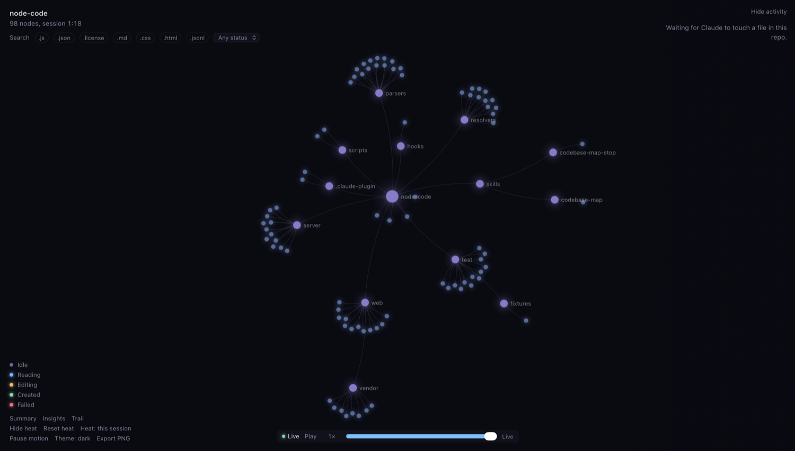
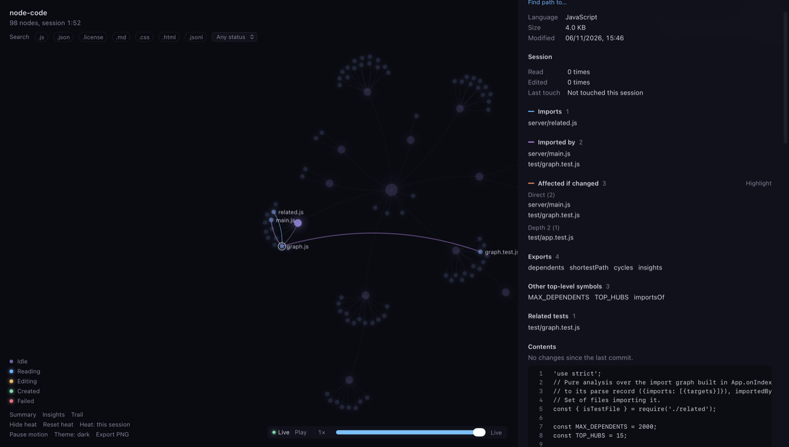
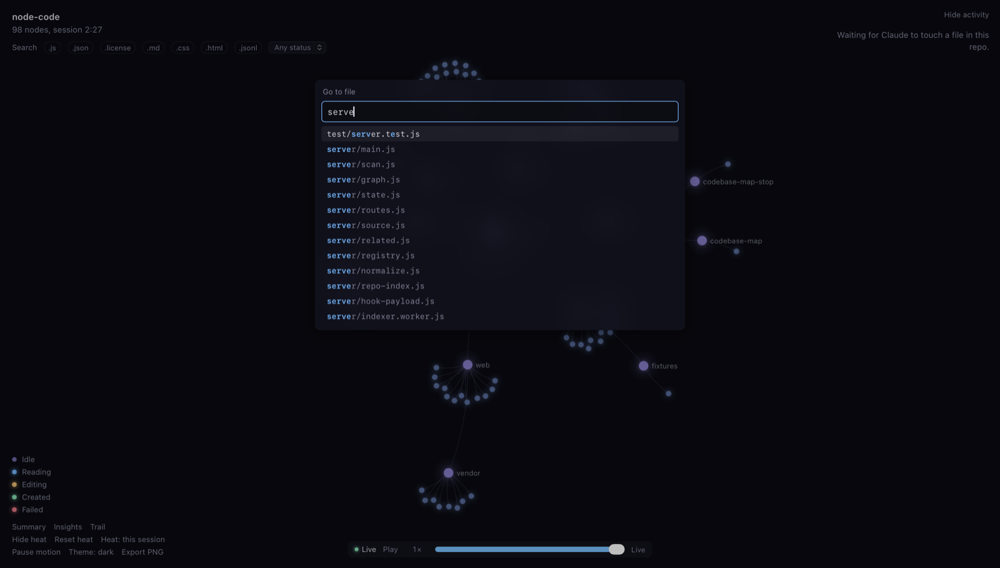
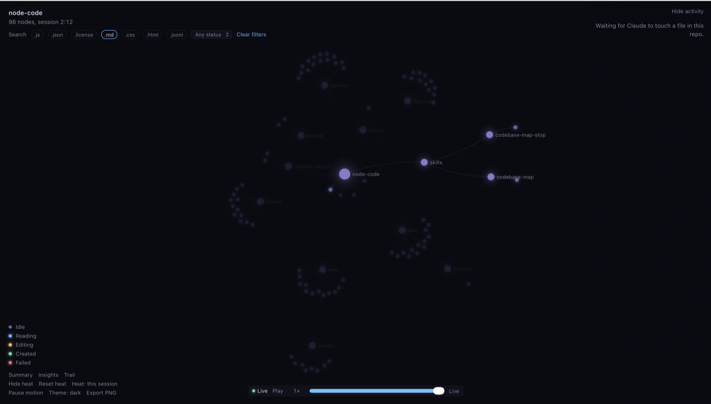

# node-code

A plugin for Claude Code, GitHub Copilot CLI and OpenCode that shows your repository as a live force-directed graph in a local web page. Nodes light up as the agent reads and edits files, and clicking a file shows its details and dependencies.



Building the graph is local and uses no model tokens. Nothing leaves your machine: the server listens on 127.0.0.1 only. Hooks send it file paths, search patterns, and the first 300 characters of Bash commands and of error messages from failed calls. File contents and successful tool output are dropped before anything is sent.

## Install

Requires Node 20 or later (tested on 24), and Claude Code 2.1.318, Copilot CLI 1.0.107 or OpenCode 2.2.5 or later (the versions it was tested on). It has no dependencies.

### The `node-code` command

Starts and stops the map from a terminal, at no token cost. Copilot CLI and OpenCode need it; for Claude Code it is optional.

```bash
npm install -g github:matiomacedo/node-code
```

If your global npm folder needs root, link the command into a folder on your `PATH` instead, from a local clone:

```bash
ln -s "$PWD/node-code/scripts/node-code.js" ~/.local/bin/node-code
```

### Claude Code

Install it from GitHub for every session:

```bash
claude plugin marketplace add matiomacedo/node-code
claude plugin install node-code@node-code-local
```

Or from a local clone, which loads the plugin straight from that folder so your edits apply:

```bash
git clone https://github.com/matiomacedo/node-code.git
claude plugin marketplace add ./node-code
claude plugin install node-code@node-code-local
```

Or try it for one session without installing:

```bash
claude --plugin-dir ./node-code
```

Start a new session after installing, so the hooks load.

### GitHub Copilot CLI

Install the plugin, which adds the hooks and the `codebase-map` and `codebase-map-stop` skills.

```bash
copilot plugin install matiomacedo/node-code
```

### OpenCode

Copy the plugin and the `/codebase-map` and `/codebase-map-stop` commands into your OpenCode config.

```bash
NC="$(npm root -g)/node-code/opencode"
mkdir -p ~/.config/opencode/plugins ~/.config/opencode/commands
cp "$NC/node-code.js" ~/.config/opencode/plugins/
cp "$NC"/commands/*.md ~/.config/opencode/commands/
```

### Differences from Claude Code

- **Copilot** edits through `apply_patch`. A patch that touches several files pulses the first one and refreshes the rest; deleted files leave the graph on the next scan, within 30 seconds. A shell command that exits non-zero shows as failed. Copilot waits for its hooks, which adds about 20 ms before and after each file or shell tool call.
- **OpenCode** runs `node-code` once per tool event, as Claude Code's hooks do. If `node-code` is not on the `PATH` that OpenCode sees, nothing is shown and nothing breaks. Its `patch` tool, offered only to some models, is mapped like Copilot's but was not seen in testing.

## Usage

Start the map from a terminal in the repo. This uses no model tokens, and the map shows every agent working in that repo:

```bash
node-code start   # starts the server for this repo and opens the page
node-code stop    # stops it
```

Or start it from inside an agent, which costs one small model turn:

| Agent | Start | Stop |
| --- | --- | --- |
| Claude Code | `/node-code:codebase-map` | `/node-code:codebase-map-stop` |
| Copilot CLI | ask for the `codebase-map` skill | ask for the `codebase-map-stop` skill |
| OpenCode | `/codebase-map` | `/codebase-map-stop` |

Starting reuses a server that is already running, and only opens a tab if none is connected. A map started with Claude Code's command shows only Claude Code, because only Claude Code can find it; one started any other way shows all three agents.

Claude Code namespaces plugin commands. Typing `/codebase-map` and pressing Enter works in an interactive session, because autocomplete selects the full name. It does not work in `claude -p`, where you must use the full name.

The server also exits on its own after 30 minutes with no page open and no activity.

### In the page

- **Pan** by dragging the background, **zoom** with the wheel or a pinch, **drag** nodes to move them.
- **Hover** a node for its full path. Labels also appear when you zoom in.
- **Click a file** to open its details and show its dependency edges. The panel also shows the file's contents and, in a git repo, what changed since the last commit (Claude's edits and your own), with changed lines marked. This is read from disk by the local server and uses no model tokens. **Click a folder** to collapse or expand it. **Click "N more"** to show more files in a very large folder.
- **Click a feed entry** to jump to its node.
- **Hide heat** or **Reset heat** at the bottom left. Resetting keeps the read and edit counts in the details panel.
- **Pause motion** at the bottom left stops the graph's slow ambient drift; **Resume motion** starts it again. The choice is remembered in that browser. Motion starts paused if Reduce motion is on in your system settings, and it pauses while the tab is hidden.
- **Hide activity** at the top right slides the feed away; the same button then reads **Show activity**.
- **Esc** closes the details panel.



#### Reviewing a session

- **Search** with Cmd-K (Ctrl-K), `/` or the Search button: type part of a path and press Enter to jump to the file.
- **Filter** with the bar under the repo name: file extensions, status (touched, read, edited, failed), and, when there is more than one, session and subagent. Files that don't match are dimmed and their feed rows hidden.
- **Replay** with the timeline at the bottom: drag it back to see the heat and feed as they were, **Play** at 1×, 10× or 50×, and **Live** to return. Live activity keeps arriving while you scrub and is applied when you return.
- **Summary** at the bottom left: duration, counts, hotspots, the files edited and created (they open on the Changes tab), files edited without being read first, files that import an edited file but were never read, and failed calls.
- **Alerts** pop up at the bottom right when one file is edited 5 times in 10 minutes or the same Bash command fails 3 times in a row.

| Search | Filter by extension |
| --- | --- |
|  |  |

#### Dependency insights

- **Affected if changed** in the file panel lists every file that imports it, directly or indirectly. **Highlight** rings them in the graph. Edits in the feed show the same count as **→ N**.
- **Find path to…** in the file panel: pick another file to see the chain of imports that connects them.
- **Insights** rings files in import cycles, the 15 most imported files, and parsed files with no imports either way (tests excluded).
- **Trail** draws the order of the last 30 files Claude touched.
- **Heat: this session** switches to **Heat: git, 90 days**, which colors files by how many of the last 500 commits in 90 days changed them.
- **Theme** cycles auto, light and dark. **Export PNG** saves the current view.

### What the colors mean

| Status | Shown when |
| --- | --- |
| Reading | Read, Grep or Glob, or a read-only Bash command (`cat`, `head`, `tail`, `sed -n` and similar) naming the file |
| Editing | Edit, Write or NotebookEdit, or a Bash command that changed the file |
| Created | Write created the file, or a Bash command did |
| Failed | The tool call failed |
| Idle | Everything else. Nodes settle back here after each pulse |

Node size and glow grow with the session's touch count. Grep, Glob and read-only Bash pulse nodes but add no heat, so one broad search doesn't paint the whole repo as hot.

## Dependency parsing

| Language | Extensions | Handles |
| --- | --- | --- |
| JavaScript and TypeScript | `.js .jsx .mjs .cjs .ts .tsx .mts .cts` | ESM, CommonJS, dynamic imports, re-exports, `.js` to `.ts` mapping, index files, `paths` and `baseUrl` from the root `tsconfig.json` |
| Python | `.py .pyi` | `import`, `from`, multi-line and relative imports, `__all__`, `src/` layouts, sibling scripts |
| C and C++ | `.c .h .cc .cpp .cxx .hh .hpp .hxx` | `#include "..."` beside the file, in `include/` and `src/`, or by a unique path suffix; `<...>` includes only when they match a repo file |
| Go | `.go` | Package imports under any `go.mod` module in the repo, to that package's non-test files |
| Rust | `.rs` | `mod x;`, `use crate::`, `super::`, `self::` and bare module paths, nested `{}` groups |
| Java, Kotlin, Scala | `.java .kt .kts .scala` | Class, static, wildcard and Scala selector imports, through each file's `package` |
| C# | `.cs` | `using`, `global using`, `using static` and aliases, through each file's `namespace` |
| Ruby | `.rb` | `require_relative`, and `require` from `lib/` |
| PHP | `.php` | `require` and `include` (also with `__DIR__`), `use` through the `composer.json` PSR-4 map |
| Shell | `.sh .bash .zsh` | `source` and `.`, with `$DIR/`-style paths taken as the script's folder |
| CSS, SCSS, Less | `.css .scss .less` | `@import`, `@use`, `@forward`, Sass partials and index files |
| HTML | `.html .htm` | Local `<script src>` and `<link href>` |
| Vue and Svelte | `.vue .svelte` | Imports in `<script>` blocks |

Other files appear in the graph with their language name but no dependency data.

To add a language, write a parser and a resolver and register them in `parsers/registry.js`. That file documents the interface.

## Known limits

- **Import parsing is regex-based.** Computed imports don't resolve, and neither do monorepo package links beyond the root `tsconfig.json`. Files over 512 KB and minified files are not parsed. Swift is not parsed, since it imports whole modules, and neither is indented Sass (`.sass`). One import shows at most 50 targets, so a C# namespace or Go package with more files is cut off.
- **Diffs need git.** The panel diffs against `HEAD`, so outside a git repo, or before the first commit, it shows the file without changes. Files over 512 KB show only their first 512 KB, and binary files are not shown.
- **Bash attribution is best effort.** Claude Code's `bashEditDiff` field is used when present, but it is in public beta and did not appear in testing. The fallback rescans the repo after each Bash call and credits changes to that call, so an unrelated change made in the same moment gets credited too. Changes from background commands appear within 30 seconds, with no status color.
- **Pulses are not replayed.** After a dropped connection, the page restores the feed, heat and tree from the server, but misses any pulses during the gap.
- **Session history lives in memory.** Replay, filters by session and the summary cover only the current server run, up to 20,000 calls. Stopping the server forgets them. The timeline replays heat and pulses; the feed keeps its last 500 rows.
- **Root-absolute imports don't resolve.** An import like `'/tree.js'` (served from the web root) has no edge, so blast radius, paths and insights miss it.
- **Grep and Glob results are undocumented.** Matched files are read from fields observed in Claude Code 2.1.318. If they change, searches will still pulse the searched folder and appear in the feed.
- **Large searches pulse only some files.** At most 100 matched files pulse per search. In Copilot, whose search results are plain text, only the first 5000 lines are read, so matches past that point don't pulse; the search still appears in the feed.
- **MultiEdit is not in the current hook docs.** It stays in the matcher in case older versions send it.
- **A session in another repo is routed by path.** A tool call goes to the repo containing its file, or else its working directory. Only one feed per repo exists, with all its sessions mixed; the session ID is in each entry's tooltip.
- **Some source folders are skipped by name:** `build`, `dist`, `out`, `target`, `coverage`, `venv` and similar, even when they are tracked. Symlinks are not shown.
- **Size caps:** 2,000 visible nodes, 200 files per folder page (click "N more" for the next page), 100,000 files scanned.
- **Tested on macOS only.** The Linux and Windows browser-open commands are written but untested, and PowerShell tool calls are not tracked.

## Development

```bash
npm test                          # unit and integration tests, no dependencies
claude plugin validate .          # manifest and hooks check
claude --plugin-dir .             # load it, then /reload-plugins after edits
```

The server keeps its web assets in memory, so restart it with `/node-code:codebase-map-stop` to see front-end changes.

`test/fixtures/hook-payloads.jsonl` holds real hook payloads captured from Claude Code 2.1.318. Add `&perf=1` to the page URL to record frame times and expose `window.__nc` for debugging.

`web/vendor/` contains `d3-force` 3.0.1 and its dependencies (ISC license; license files alongside).

## License

MIT, see [LICENSE](LICENSE). The bundled d3 files in `web/vendor/` are ISC licensed.
